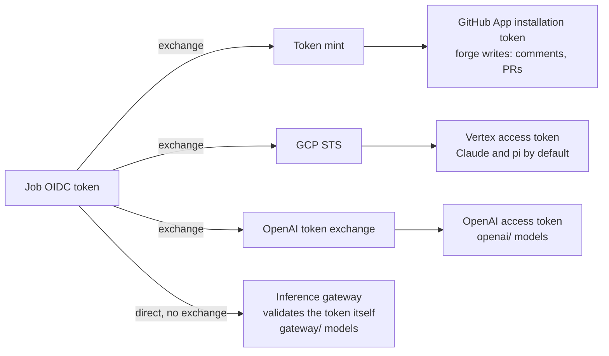

# How fullsend authenticates

On GitHub Actions, almost every credential fullsend uses starts from one thing: the OIDC token
that GitHub issues to the job. Different services trust that token in different ways. This page
names each path, says what the agent sandbox ends up holding, and tells you which path applies
in your case. Read it before [Getting Inference](../getting-started/getting-inference.md) and
[Using an inference gateway](inference-gateway.md).

"WIF" gets used for three different things. They are not the same:

- **GCP Workload Identity Federation (WIF):** GCP's Security Token Service (STS) exchanges the
  OIDC token for a Vertex AI access token.
- **OpenAI Workload Identity:** OpenAI's token exchange swaps the OIDC token for a short-lived
  OpenAI access token.
- **Direct OIDC trust (no token exchange):** the inference gateway's `auth: oidc` mode. The
  gateway validates the OIDC token itself. Nothing is exchanged, and it is not WIF.

This page is a map. The trust boundaries are described in
[Architecture § Agent Identity Provider](../../architecture.md#agent-identity-provider), and each
walkthrough page linked below has the step-by-step flow.

## The paths at a glance

## What each path holds

A **placeholder** is a stand-in value. The sandbox sees only the placeholder, and the OpenShell
proxy swaps in the real credential on the way out, so the real credential never enters the
sandbox.

| Path | What trusts the OIDC token | Exchange or direct | What the sandbox holds | Lifetime | Secret stored on the forge | Fallback |
|---|---|---|---|---|---|---|
| [Token mint](../infrastructure/mint-administration.md) | The mint. It checks the token with GCP STS on a Cloud Function mint, or with GitHub's signing keys on a Cloudflare Worker or [standalone mint](../infrastructure/standalone-mint.md) | Exchange, for a GitHub App installation token | A placeholder | 60 minutes | None. The App private keys stay in the mint; the forge stores only the mint URL, as a variable | A personal access token on a local run |
| [GCP WIF](../getting-started/getting-inference.md) | GCP STS, through your WIF provider | Exchange, done inside the sandbox by Google's auth library | An `external_account` file and the job's real OIDC token | The runner refreshes the OIDC token every 4 minutes | No key. `FULLSEND_GCP_PROJECT_ID` and `FULLSEND_GCP_WIF_PROVIDER` are stored as secrets, but they are identifiers | An existing credential file in `GOOGLE_APPLICATION_CREDENTIALS` when both are unset |
| [OpenAI WIF](../infrastructure/openai-workload-identity.md) | OpenAI's token exchange, through an identity provider in your OpenAI organization | Exchange, done by the runner | A placeholder | Minutes: never longer than the OIDC token, one hour at most. The runner renews it for the whole run | None. Three identifiers live in the committed `inference.openai` block of `config.yaml`; repository variables override them | `FULLSEND_OPENAI_API_KEY`, used only when no WIF configuration applies to the run |
| [Gateway `auth: oidc`](inference-gateway.md#choosing-auth) | The inference gateway | Direct: the gateway validates the token itself | A placeholder | The OIDC token's own expiry. The runner seeds a fresh token before it expires | None | None at run time. A gateway that cannot trust forge OIDC uses `auth: api-key` instead |
| [Gateway `auth: api-key`](inference-gateway.md#choosing-auth) | Nothing: no OIDC token is used | Neither: a static gateway key | A placeholder | Until the gateway operator revokes the key | A key: `FULLSEND_INFERENCE_GATEWAY_API_KEY` | None. The run fails if the key is missing or refused |

## Which path applies

- **Claude on Vertex** → GCP WIF. See [Getting Inference](../getting-started/getting-inference.md).
- **GPT on pi or Codex** → [OpenAI Workload Identity](../infrastructure/openai-workload-identity.md),
  or an API key in `FULLSEND_OPENAI_API_KEY`.
- **Any model through your organization's gateway** → the gateway route, preferably with
  `auth: oidc`. It works on pi, Claude Code and Codex today; Codex needs a gateway that serves the
  Responses API. See [Using an inference gateway](inference-gateway.md).
- **A local run** → there is no OIDC token. Use a Google credential file in
  `GOOGLE_APPLICATION_CREDENTIALS` (Application Default Credentials) for Vertex, `OPENAI_API_KEY`
  for OpenAI, and `auth: api-key` for the gateway. See
  [Running agents locally](running-agents-locally.md).
- **GitLab** → Vertex uses the job's `id_tokens:` token (`FULLSEND_ID_TOKEN`) with GCP WIF. The
  rest differs from GitHub today:
  - The mint is GitHub-only. GitLab forge writes use per-role tokens stored as masked CI/CD
    variables; see [Configuring GitLab](../getting-started/configuring-gitlab.md#role-identity-model-and-credential-lifecycle).
  - OpenAI Workload Identity is GitHub Actions only. GitLab uses an API key in
    `FULLSEND_OPENAI_API_KEY`.
  - The gateway works with `auth: api-key`. `auth: oidc` does not apply on
    GitLab: the gateway route does not accept GitLab ID tokens yet.

## Who does what

Setting up inference usually needs more than one person. The reader of a setup guide is usually
the repo admin or a repo writer, and the other two roles sit outside the repository. Each step
below links to the page with the detail.

| Role | Holds | Steps they own |
|---|---|---|
| **Repo admin** | GitHub admin on the repository | Runs [`fullsend github setup`](../getting-started/configuring-github.md) with the values the other roles hand over. Records the OpenAI identifiers ([step 4](../infrastructure/openai-workload-identity.md#4-tell-fullsend-the-three-identifiers)). Writes the gateway block ([Write the block](inference-gateway.md#write-the-block)). Stores an API key as a repository secret where a route uses one ([OpenAI route C](../infrastructure/openai-workload-identity.md#c-static-key-as-a-repository-secret), [gateway `auth: api-key`](inference-gateway.md#choosing-auth)). |
| **Repo writer** | Write access, enough to add a workflow | Adds the OpenAI claim-check workflow ([step 1](../infrastructure/openai-workload-identity.md#1-see-what-your-repository-actually-claims-both-routes)). Adds a workflow with `id-token: write` to run the live check of [`fullsend inference openai status`](../../cli/inference.md#inference-openai-status) or [`fullsend inference gateway status`](../../cli/inference.md#inference-gateway-status). |
| **Provider admin** | The OpenAI organization admin, or the inference gateway operator | OpenAI organization admin: adds the identity provider and the repository's mapping ([A2](../infrastructure/openai-workload-identity.md#a2-add-or-reuse-the-identity-provider-route-a), [A3](../infrastructure/openai-workload-identity.md#a3-map-the-repository-to-a-service-account-route-a)), then hands over the audience, the identity provider ID and the service account ID. Gateway operator: runs the gateway ([operator guide](../infrastructure/inference-gateway-operator.md)), allows or [removes](../infrastructure/inference-gateway-operator.md#remove-a-repository) the repository, and hands over the gateway URL and the audience. |
| **GCP project admin** | IAM admin on the GCP project used for Vertex | Enables the APIs and runs [`fullsend inference provision`](../getting-started/getting-inference.md#configure-inference-in-your-gcp-project), then hands over the GCP project ID and the WIF provider. |

If you have no OpenAI platform access at all, see
[If you have no OpenAI platform access](../infrastructure/openai-workload-identity.md#if-you-have-no-openai-platform-access).

## Not supported yet: gateway token exchange

The inference gateway does not do WIF. A gateway credential mode based on
token exchange, for gateways that trust only their own identity provider, is
not available: Fullsend cannot exchange the forge OIDC token for a gateway
credential through a WIF or STS service. Today the gateway either validates
the forge OIDC token directly (`auth: oidc`) or takes a static key
(`auth: api-key`).

## Related

- [Getting Inference](../getting-started/getting-inference.md): set up GCP WIF for Vertex
- [Using an inference gateway](inference-gateway.md): the gateway route and its `auth` modes
- [OpenAI Workload Identity](../infrastructure/openai-workload-identity.md): GPT models without a
  stored key
- [Configuring GitHub](../getting-started/configuring-github.md): install the GitHub Apps that the mint issues
  tokens for
- [Mint service administration](../infrastructure/mint-administration.md): deploy and run the
  token mint
- [Architecture § Agent Identity Provider](../../architecture.md#agent-identity-provider): trust
  boundaries and credential delivery
